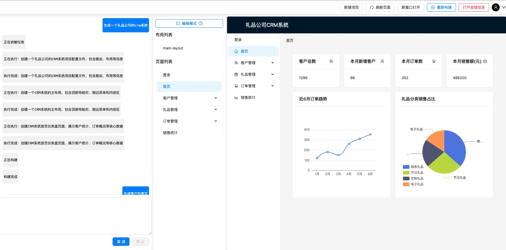
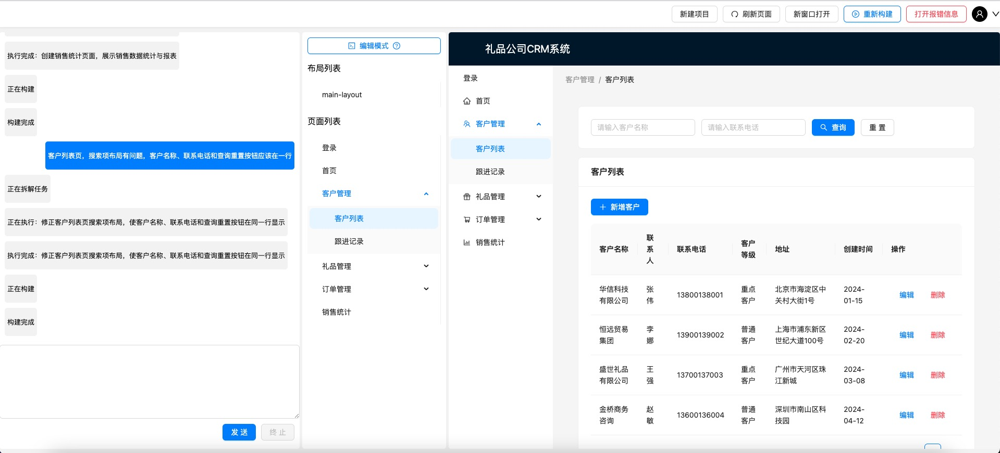

# Quick build——Project building tools for everyone

**Through multi-Agent collaboration and based on a low-code engine, natural language requirements are transformed into directly interactive business applications. No code knowledge is required, and it does not rely on agents to generate source code. It can be generated very quickly and build a complete project in 5 minutes.**

## How It Works

* Two agents collaborate
* The agent outputs low-code within the constraints.
* The program builds interactive applications based on low-code.

## Demo

📺 **[Watch Demo Video](https://bxsbl.oss-us-west-1.aliyuncs.com/quickbuild/build_crm_correct.mp4)**

🔗 **[Try the Live Demo](http://quickbuild.bxsbl.com/ttadmin_front/home)** 

🔗 **[Project built and deployed entirely using this tool require no human intervention in the code.](http://quickbuild.bxsbl.com/gift-crm-6aaf7adf719ae899bad5507a/dashboard)** 

* Screenshots:

1、Init a project

2、Correcting errors through dialogue

## Example Use Case

Imagine building an administration page for managing suppliers.

You describe the requirements:

> Create a CRM system for a gift company.

The AI generates a structured page description, and the engine renders the corresponding interface.

The same approach can be explored for other business-oriented interfaces, depending on the components and capabilities supported by the current implementation.

## Try It

Experience the application through the online demo:

**[Open the Live Demo →](http://quickbuild.bxsbl.com/ttadmin_front/home)**

## Feedback is welcome, especially on:

- Business scenarios you would like to build
- Missing components or capabilities
- Potential integration and collaboration opportunities
- **email: scyan@bxsbl.com**

---
# QuickBuild(人人可用的项目构建工具)

**通过多Agent协作，基于低代码引擎，将自然语言需求转化直接可交互的业务应用。无需代码知识，不依赖Agent生成源码，极速生成，5分钟构建一个完整项目。**

## 工作原理

* 两个Agent协作
* Agent输出框架内的低代码
* 程序根据低代码构建可交互的应用

## Demo

📺 **[观看Demo视频](https://scyan-test.oss-cn-beijing.aliyuncs.com/build_crm_correct.mp4)**

🔗 **[在线体验](http://quickbuild.bxsbl.com/ttadmin_front/homeL)** 

🔗 **[完全通过这个工具构建并部署的项目，没有人为介入代码](http://quickbuild.bxsbl.com/gift-crm-6aaf7adf719ae899bad5507a/dashboard)** 

## 应用场景示例

以供应商管理页面为例。

用户输入需求：

> 创建一个供应商管理系统，包含搜索表单、数据表格，以及用于编辑供应商信息的弹窗。

AI 根据需求生成结构化页面配置，低代码引擎再将其渲染为可交互的界面。

根据当前实现支持的组件和能力，这种方式也可以用于探索其他业务页面的构建场景。

## 在线体验

欢迎直接体验：

**[进入在线体验 →](http://quickbuild.bxsbl.com/ttadmin_front/home)**

## 也欢迎反馈以下内容：

- AI 生成页面的质量和一致性
- 希望支持的业务场景
- 当前缺少的组件或能力
- 潜在的集成与合作机会
- **联系邮箱: scyan@bxsbl.com**
